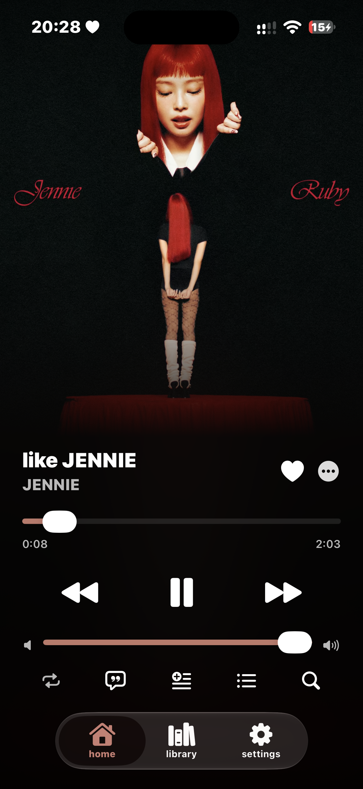
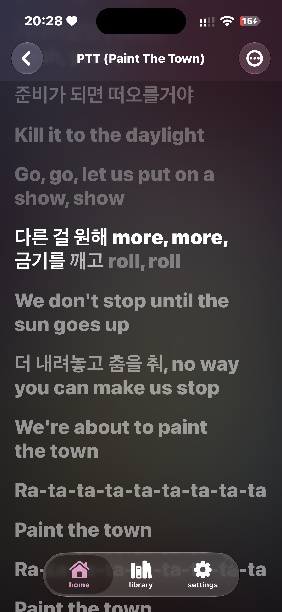
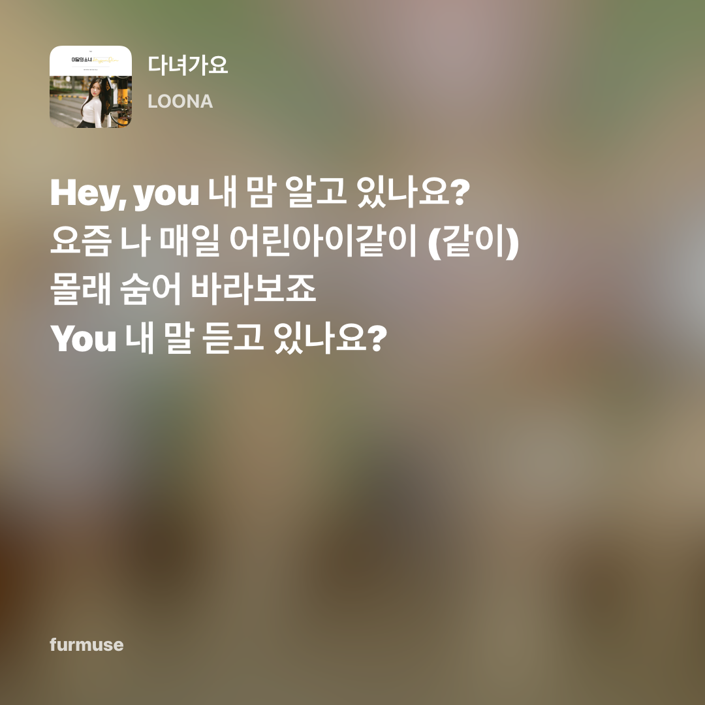

<p align="center">
  
</p>

<h1 align="center">furmuse</h1>

<p align="center">your music, your covers, your way.</p>

<p align="center">a simple iphone music player with spotify, youtube audio, local files, synced lyrics, animated artwork and lyric cards.</p>

---

furmuse gives your music an apple music-inspired player while letting you choose where songs, artwork and lyrics come from.

it includes:

* spotify search and playlist importing
* fast youtube audio playback
* local music files and downloads
* synced, word-by-word lyrics
* spotify canvas and apple music animated artwork
* custom still and animated album covers
* lock screen artwork and lyric display
* equalizer, bass boost, reverb and speed controls
* shareable lyric cards

## screenshots

<p align="center">
  
  &nbsp;
  
  &nbsp;
  <video width="220" controls playsinline>
  <source src="./docs/screenshots/kissntell.mp4" type="video/mp4">
  Your browser does not support this video.
  </video>

</p>

<p align="center"><b>now playing · synced lyrics · lock screen</b></p>

<p align="center">
  
</p>

<p align="center"><b>lyric card</b></p>

---

## install — easiest option

**use the release unless you specifically want to edit or build the app yourself.** it is the shortest and easiest option.

1. open the [latest release](https://github.com/mrwolfstip/furmuse/releases/latest)
2. download `furmuse.ipa`
3. the ipa is unsigned, so install and sign it with an ios sideloading app such as sideloadly or altstore
4. open furmuse on your iphone and follow the setup screens — setup can also be skipped

free apple ids normally need the app to be signed again every seven days. paid apple developer accounts have longer signing periods. that limit comes from apple, not furmuse.

## build it yourself on a mac

use this option if you want to build directly from the source code.

### what you need

* a mac
* xcode
* an apple id
* rust, only for the spotify “with effects” player

### 1. download the project

pick either method:

* on github press **code → download zip**, then unzip it
* or open terminal and run:

```sh
git clone https://github.com/mrwolfstip/furmuse.git
cd furmuse
```

### 2. install rust

open terminal and run:

```sh
curl --proto '=https' --tlsv1.2 -sSf https://sh.rustup.rs | sh
```

when it finishes, close terminal and open it again.

### 3. open the app in xcode

double-click `furmuse.xcodeproj`, or run this inside the project folder:

```sh
open furmuse.xcodeproj
```

### 4. choose your iphone signing account

1. connect your iphone to the mac
2. in xcode, click the blue **furmuse** project on the left
3. select the **furmuse** target
4. open **signing & capabilities**
5. choose your team
6. if xcode asks for a unique bundle identifier, change `wolf.knots.player` to something like `com.yourname.furmuse`

### 5. build and install

1. choose your iphone from the device menu at the top of xcode
2. press the play button, or press `command-r`
3. wait for xcode to build and install furmuse

the first build takes longer because xcode downloads youtubekit and rust builds the spotify audio library.

## setup

setup can be skipped. youtube and local files work without spotify.

for spotify search and playlist imports:

1. create an app in the [spotify developer dashboard](https://developer.spotify.com/dashboard)
2. add `wolfified://callback` as its redirect uri
3. copy the spotify client id
4. paste it into furmuse when asked, or later in **settings → spotify**
5. connect your spotify account

spotify playlist importing works with free accounts. spotify playback may require premium depending on the playback method.

last.fm is optional. its api key and shared secret can be added under **settings → last.fm**.

## automatic ipa release

every push to `main` or `master` runs the github actions workflow. it builds an unsigned ipa and puts it in the `v1` release.

if the release cannot be created, open **settings → actions → general** in the github repository and set **workflow permissions** to **read and write permissions**.

## privacy and keys

spotify and last.fm keys entered in the app are stored in the ios keychain. personal keys, tokens, signing files and build products are ignored by git.

furmuse is an independent project. it is not affiliated with spotify, apple, youtube or last.fm. use connected services according to their terms.
